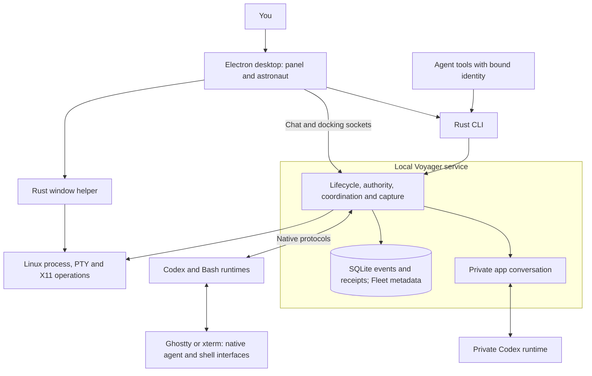
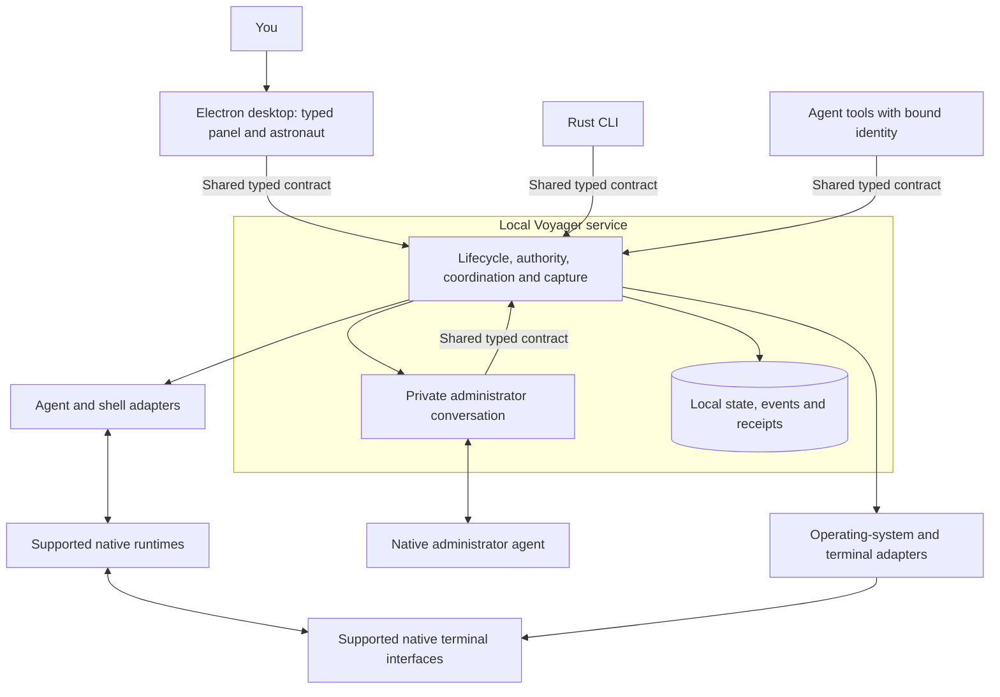

# Voyager Shell

Voyager Shell is a local development app being built to help people and agents work
together through an intuitive interface. It is designed to fit alongside your
existing tools and agents, with tools for communication, coordination, and
event collection. You choose how to combine and configure them to support your
workflow.

In the future, users will be able to join communities called voyages to collaborate
on shared projects. Events will remain stored locally. Joining a voyage will let
users share useful context extracted from those events through a structured
knowledge graph that agents can access and people can inspect and validate.

**Current status:** an experimental local app with a Rust service and an Electron
desktop client. Native trials have used Fedora GNOME/XWayland, Codex, Bash, and
dedicated Ghostty or xterm windows. Broader agent and platform support, voyages,
and knowledge graphs are future work.

[Capabilities](#capabilities) · [Quick start](#quick-start) ·
[Current system](#current-system) · [Proposed system](#proposed-system) ·
[Contributing](CONTRIBUTING.md)

## Capabilities

A **Vessel** is a registered agent or terminal. A **Fleet** groups related Vessels
without changing their permissions.

| Task                                                                        | Entry point and detailed guide                                                                                                       |
| --------------------------------------------------------------------------- | ------------------------------------------------------------------------------------------------------------------------------------ |
| Create Codex agents or persistent Bash terminals.                           | Panel **+**; [Vessels](docs/instances.md).                                                                                           |
| Open, background, stop, rename, remove, or explicitly resume eligible work. | Vessel menus and Previous vessels; [lifecycle](docs/lifecycle.md).                                                                   |
| Group Vessels and arrange their native windows.                             | Fleet creation, drag/drop, and Fleet selection; [Fleets](docs/fleets.md).                                                            |
| Select a current agent by docking the astronaut.                            | Drag onto a supported managed terminal; [desktop gestures](docs/desktop.md).                                                         |
| Delegate work, send instructions, report results, and escalate questions.   | Bound agent CLI tools; [authority and coordination](docs/authority.md).                                                              |
| Administer Vessels and Fleets through text or supported voice.              | Panel chat and soundwave; [private conversation](docs/harness-runtime.md).                                                           |
| Inspect captured messages, turn outcomes, and action receipts.              | CLI event pages and watchers; [service reference](docs/service.md).                                                                  |
| Run commands in a shared managed Bash session and read bounded output.      | `shell-exec` and `shell-read`; [Vessel commands](docs/instances.md#the-same-operations-from-an-agent-or-script).                     |
| Observe an explicitly connected external Codex thread.                      | CLI discovery and registration; [service setup](docs/service.md#build-and-run). This grants no process ownership or desktop docking. |
| Authorize an isolated development checkout trial.                           | Explicit owner grant; [development runs](docs/development-tests.md).                                                                 |

See the [full capability reference](docs/capabilities.md) for actions, permissions,
and effects, and the [CLI reference](docs/service.md#commands) for command syntax.

## Quick start

Requires Git, [stable Rust](https://rust-lang.org/tools/install/) with a C linker,
[Node.js 24](https://nodejs.org/en/download) and npm, and
[Ghostty](https://ghostty.org/docs/install/binary) or xterm at `/usr/bin/ghostty`
or `/usr/bin/xterm`. Run from a Linux graphical session with XWayland.

Install and authenticate [Codex CLI](https://learn.chatgpt.com/docs/codex/cli) for
agent Vessels and private chat. Bash Vessels work without Codex.

```sh
git clone https://github.com/isaacasamoah/voyagershellapp.git
cd voyagershellapp
cargo build --locked --bins
npm --prefix desktop ci
node desktop/node_modules/electron/install.js
npm --prefix desktop start -- --ozone-platform=x11 --expanded
```

The app starts or reconnects to the local service and opens the panel. State
is stored under `~/.local/share/voyagershell` by default. Closing Electron leaves
the service and managed work running; login startup is not installed.

### Create and manage a Vessel

Use **+** to create a Codex or Bash Vessel with a name, project directory, and
viewer. Ghostty is the default; select xterm if that is your installed terminal.
Click a Vessel card to open or bring forward its native interface.

Voyager-created Codex sessions currently use YOLO, disabling the native command
sandbox and approval prompts. External registrations retain their settings.
Configurable permission defaults remain future work.

The Vessel menu separates **Run in background**, **Stop**, and **Remove**.
Background closes the viewer and retains the runtime. Stop ends the runtime.
Remove ends future capture and instruction routing while retaining history.
Stop managed Vessels before selecting **Stop service** from the panel menu.

Use panel chat to administer Vessels and Fleets. Drag the astronaut onto a
supported managed terminal to dock; see [desktop gestures](docs/desktop.md) and
[authority](docs/authority.md) for the resulting control scope.

### Install a desktop launcher

From a clean, committed checkout:

```sh
npm --prefix desktop run package:linux
```

Extract the archive printed under `desktop/out`, then run `./install.sh` from the
extracted directory. Launch **Voyager Shell** from Applications. The account-local
bundle includes Electron and the Rust binaries; terminals and Codex remain separate
installations. It requires no root access and does not restart an existing service.
See [Linux installation](docs/install-linux.md) for paths and retained state.

<details>
<summary>Setup and troubleshooting</summary>

- Install a C compiler/linker if the Rust build cannot find one. On Fedora:
  `sudo dnf install gcc`.
- If Electron's runtime download was skipped, run
  `node desktop/node_modules/electron/install.js`.
- If a viewer fails to open, inspect the existing Vessel before creating another;
  runtime creation may already have succeeded. Check the viewer path and selection.
- Use `VOYAGER_CODEX_BIN` for Codex outside the desktop's `PATH`, or `VOYAGER_STATE`
  for a separate private state directory. See [instance setup](docs/instances.md#start-the-app).
- Docking requires a verified managed runtime. Registering an external terminal
  alone does not make it eligible.

[Desktop setup](docs/desktop.md) · [Voice setup and limits](docs/voice.md) ·
[Development checks](CONTRIBUTING.md#run-the-checks)

</details>

## Current system

The floating astronaut and panel are the desktop interface. Agents keep their own
native interfaces. One local Rust service manages the runtimes it starts, checks
who may act, and records permitted events.



The CLI, desktop, and app assistant reach the same service decisions, although
their request definitions are maintained separately today. The desktop also uses
a separate native window helper. The private app conversation is separate from
Vessel capture and has its own in-memory history.

Source baseline:
[the accepted viewer-recovery revision](https://github.com/isaacasamoah/voyagershellapp/tree/abb9fe0a24653302434f803a9a278edd97bb8369).
Read the [lifecycle contract](docs/lifecycle.md),
[authority rules](docs/authority.md), and
[private conversation boundary](docs/harness-runtime.md) for the detailed behavior.

## Proposed system

The service architecture review proposes one typed definition of operations,
results, errors, and events for desktop, CLI, and agent callers. Agent integration,
terminal choice, and operating-system support would have separate boundaries.
One Rust service would continue to own state and enforce permissions.



The shared-contract labels identify common request definitions on each caller's
service connection. Native provider and terminal connections keep their own protocols.

The restructure is a **design proposal** pending specification and review. It
includes a TypeScript desktop and direct service requests for ordinary desktop
actions. Exact types, adapters, compatibility, and administrator permissions remain
to be specified. The [later review scope](tasks/plan.md#later-combined-polish-review)
records this work.

The existing [specification index](SPEC.md) covers approved user journeys:

| Specification                                      | Behavior it defines                                                                                  |
| -------------------------------------------------- | ---------------------------------------------------------------------------------------------------- |
| [Docking recovery](SPEC-docking-recovery.md)       | Verify a supported target, explain refusal, and keep the astronaut recoverable.                      |
| [Voice handoff](SPEC-voice-handoff.md)             | Acknowledge delegated requests and return their actual results, with readable text when audio fails. |
| [Conversation resume](SPEC-conversation-resume.md) | Explicitly resume eligible stopped conversations and verify surviving runtimes before reconnecting.  |
| [Current-work panel](SPEC-current-work-panel.md)   | Keep current work visible and expose previous conversations and supported recovery actions.          |

The [active task record](tasks/todo.md) tracks build and review evidence for the
approved journeys. Voyages and knowledge extraction remain future direction,
without implementation specifications in this repository.

## Support and limits

Native evidence covers Fedora GNOME/XWayland with dedicated Ghostty and xterm
windows, including Codex 0.162.x and 0.163.0. Other Linux environments, macOS,
Windows, native Wayland terminals, tabs, and additional agent integrations require
separate implementation or verification. Later working branches and installed
builds may differ from the source baseline above.

Voice depends on provider, account, terminal, and OS capabilities. The accepted
viewer-recovery work retains a deferred native voice-start failure; see
[the acceptance record](SPEC.md#this-build-branch) and [voice limits](docs/voice.md).
An accepted instruction is a submission; task completion and result quality need
separate evidence. The service does not automatically replay uncertain work.

The Linux archive installer is experimental. Signed releases, automatic updates,
voyage sharing, and knowledge extraction are not available yet.

## Contributing and further reading

The [contribution guide](CONTRIBUTING.md) covers setup, checks, source ownership,
small experiments, and PR review. The project uses the [MIT license](LICENSE).
Reports of real workflows, failures, and integration limits are welcome.

Start with [the specification index](SPEC.md) for approved requirements,
[the CLI reference](docs/service.md#commands) for scripting,
[the worker guide](skills/voyager-worker/SKILL.md) for agent use, and
[the research](docs/research.md) for ideas we have investigated.
