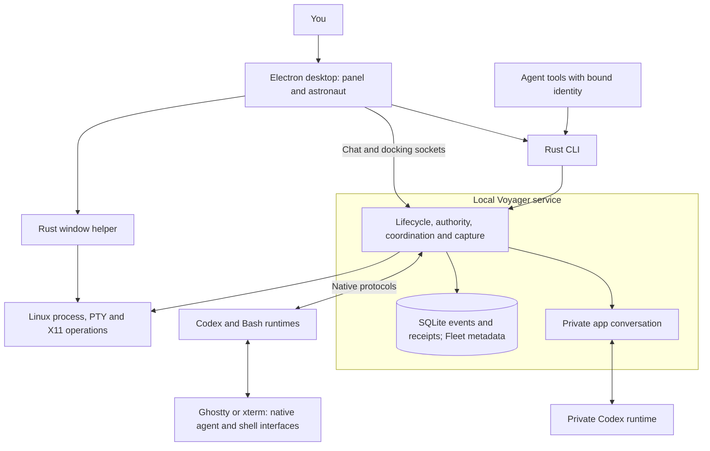
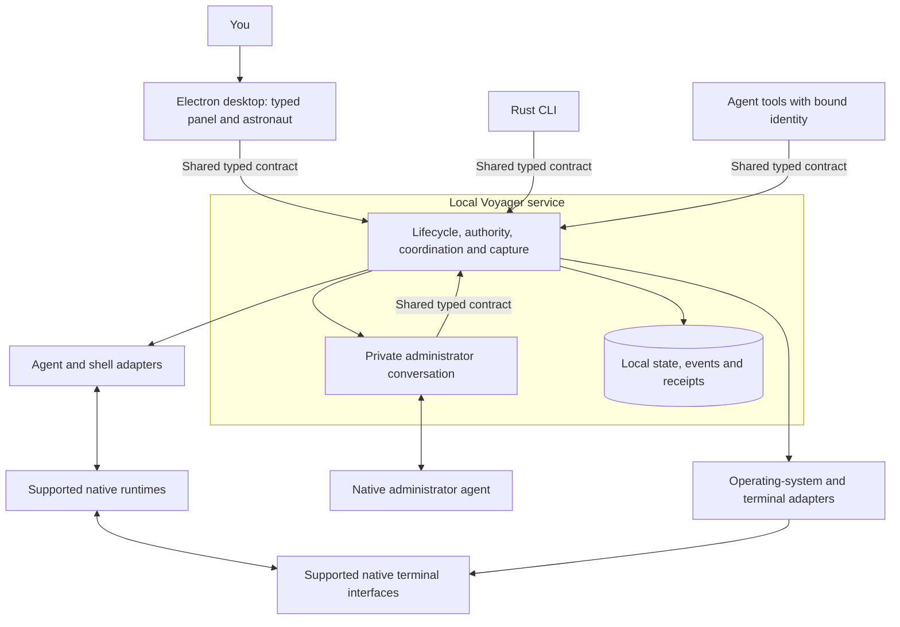

# Voyager Shell

Voyager Shell is a local development app being built to help people and agents work
together through an intuitive interface. It is designed to fit alongside your
existing tools and agents, with basic tools for communication, coordination, and
event collection. You choose how to combine and configure them to support your
workflow.

In the future, users will be able to join communities called voyages to collaborate
on shared projects. Events will remain stored locally. Joining a voyage will let
users share useful context extracted from those events through a structured
knowledge graph that agents can access and people can inspect and validate.

**Current status:** an experimental local app with a Rust service and an Electron
desktop client. Native trials have used Fedora GNOME/XWayland, Codex, Bash, and
dedicated Ghostty or xterm windows. Broader agent and platform support, voyages,
and knowledge graphs are future work.

[Current system](#current-system) · [Proposed system](#proposed-system) ·
[Get started](#get-started) · [What you can do](#what-you-can-do) ·
[Contribute](CONTRIBUTING.md)

## Current system

The floating astronaut and panel are the desktop interface. Agents keep their own
native interfaces. One local Rust service manages the runtimes it starts, checks
who may act, and records permitted events. A registered agent or terminal is a
**Vessel**. A **Fleet** groups related Vessels without changing their permissions.



Closing the desktop or backgrounding a terminal leaves managed work running.
Explicit Stop ends the selected managed runtime. Removing a Vessel ends future
capture and instruction routing while retaining its recorded history.

The CLI, desktop, and app assistant reach the same service decisions, although
their request definitions are maintained separately today. The desktop also uses
a separate native window helper. The private app conversation is separate from
Vessel capture and has its own in-memory history.

This diagram describes the source baseline in
[the accepted viewer-recovery revision](https://github.com/isaacasamoah/voyagershellapp/tree/abb9fe0a24653302434f803a9a278edd97bb8369).
Read the [lifecycle contract](docs/lifecycle.md),
[authority rules](docs/authority.md), and
[private conversation boundary](docs/harness-runtime.md) for the detailed behavior.
Later working branches and an installed build can differ from this baseline.

## Proposed system

The service architecture review proposes one typed definition of operations,
results, errors, and events for desktop, CLI, and agent callers. Agent integration,
terminal choice, and operating-system support would have separate boundaries.
One Rust service would continue to own state and enforce permissions.



The shared-contract labels identify common request definitions on each caller's
service connection. Native provider and terminal connections keep their own protocols.

This is a **design proposal**, not an implemented system or an approved restructure
specification. It includes a TypeScript desktop and direct service requests in
place of spawning a CLI for ordinary desktop actions. Exact types, adapter support,
compatibility, and administrator permissions still need specification and review.
The [reconnect plan's later review scope](tasks/plan.md#later-combined-polish-review)
records that boundary. macOS and Windows require their own implementation and
native verification.

The existing [specification index](SPEC.md) covers approved user journeys:

| Specification                                      | Behavior it defines                                                                                  |
| -------------------------------------------------- | ---------------------------------------------------------------------------------------------------- |
| [Docking recovery](SPEC-docking-recovery.md)       | Verify a supported target, explain refusal, and keep the astronaut recoverable.                      |
| [Voice handoff](SPEC-voice-handoff.md)             | Acknowledge delegated requests and return their actual results, with readable text when audio fails. |
| [Conversation resume](SPEC-conversation-resume.md) | Explicitly resume eligible stopped conversations and verify surviving runtimes before reconnecting.  |
| [Current-work panel](SPEC-current-work-panel.md)   | Keep current work visible and expose previous conversations and supported recovery actions.          |

A specification states required behavior. Its existence does not establish that
every acceptance case has passed. The [active task record](tasks/todo.md) owns build
and review evidence. As changes land and are verified, update the current diagram
and remove completed changes from the proposed view. The voyage and knowledge-graph
vision above has no implementation specification in this repository yet.

## Get started

These instructions use a terminal, the application where you type commands. Run
each command in order. A command returning to the prompt without an error means
you can move to the next step. You do not need to know Rust or JavaScript to try
the app, but this early build requires installing development tools.

### 1. Check your system and install the tools

Use a Linux graphical session. The recorded desktop evidence is from Fedora GNOME
with XWayland. macOS, Windows, native Wayland terminals, tabs, and arbitrary
externally launched agent terminals are outside the current supported journey.

| Tool                              | Why it is needed                              | Setup                                                                                                                                                                 |
| --------------------------------- | --------------------------------------------- | --------------------------------------------------------------------------------------------------------------------------------------------------------------------- |
| Git                               | Download the source.                          | [Install Git](https://git-scm.com/install/linux).                                                                                                                     |
| Rust and Cargo                    | Build the local service and window helper.    | [Install Rust with rustup](https://rust-lang.org/tools/install/). Use the current stable toolchain.                                                                   |
| A C compiler/linker               | Build Rust's native dependencies.             | On Fedora, install GCC with `sudo dnf install gcc`.                                                                                                                   |
| Node.js 24 and npm                | Install and run the desktop client.           | [Install Node.js](https://nodejs.org/en/download), selecting version 24. npm comes with it.                                                                           |
| Ghostty or xterm                  | Display native agents and shells.             | [Install Ghostty](https://ghostty.org/docs/install/binary), or on Fedora run `sudo dnf install xterm`. The current paths are `/usr/bin/ghostty` and `/usr/bin/xterm`. |
| Codex CLI and a signed-in account | Run agent Vessels and Voyager's private chat. | Follow [Codex CLI setup](https://learn.chatgpt.com/docs/codex/cli), then open `codex` and sign in. Bash Vessels work without Codex.                                   |

Ghostty is the default viewer; choose xterm in the creation form if using xterm.
Native integration evidence was recorded with Codex 0.162.x and 0.163.0. Other
versions, accounts, and voice configurations need their own verification.

After installing the tools, open a new terminal and check:

```sh
git --version
rustc --version
cargo --version
node --version
npm --version
```

Node should report `v24...`. If a command says it was not found, finish that tool's
installation before continuing. Python 3.11+ is needed to run the development
tests, but not to launch the app.

### 2. Download Voyager Shell

Choose a folder where you keep projects, open a terminal there, and run:

```sh
git clone https://github.com/isaacasamoah/voyagershellapp.git
cd voyagershellapp
```

`git clone` downloads the repository into a new `voyagershellapp` folder. `cd`
moves your terminal into it. Later instructions call this the repository root.

### 3. Build and install dependencies

From the repository root:

```sh
cargo build --locked --bins
npm --prefix desktop ci
node desktop/node_modules/electron/install.js
```

The first command builds Voyager's Rust programs. The next commands install the
desktop dependencies and ensure Electron's runtime is present. The initial build
downloads dependencies and can take several minutes. `--locked` and `npm ci` use
the dependency versions recorded in this repository.

### 4. Open the app

From the same repository root, in your graphical-session terminal:

```sh
npm --prefix desktop start -- --ozone-platform=x11 --expanded
```

The panel and astronaut should appear. Opening the app starts or reconnects to the
local service. Its private state directory defaults to
`~/.local/share/voyagershell`, outside the source checkout. No login startup is
installed. To choose a different private state directory, see the
[desktop guide](docs/desktop.md#identify-a-supported-client).

Voyager-created Codex sessions currently use YOLO, which disables the native
command sandbox and approval prompts. External registrations keep their own
settings. Configurable permission defaults remain future work.

### 5. Try a Vessel

1. Click **+** in the Vessels section.
2. Choose **Terminal · Bash** for a first try without an agent account, or **Codex**
   after signing in. Give it a name and choose an existing project folder.
3. Choose your installed viewer and select **Create and open**. Its native terminal
   should open and its card should appear in Voyager.
4. For Bash, type `pwd` in that terminal. It should print your chosen folder.
5. Use the Vessel menu to **Run in background**. Its terminal closes while its
   runtime keeps running. Click its card to reopen the same work.
6. Choose **Stop** when finished. To stop Voyager itself, first stop its managed
   Vessels, then choose **Stop service** from the panel's small menu.

The panel's close button quits the desktop while the service and work keep running.
[Docking gestures](docs/desktop.md#try-the-journey) and
[agent creation](docs/instances.md) have their own walkthroughs.

### Install a desktop launcher

Running from source is enough to try Voyager. For an Applications launcher, build
an account-local Linux bundle from an unchanged, committed checkout:

```sh
npm --prefix desktop run package:linux
```

The command prints the generated archive's path under `desktop/out`. Open that
folder in your file manager, extract the new `.tar.gz` archive, and open the
extracted folder in a terminal. Run:

```sh
./install.sh
```

Then open **Voyager Shell** from Applications. Installation needs no root access
and does not add login startup or force an existing service to restart. The bundle
includes Electron and the compiled Rust programs; its users still install their
terminal and Codex separately. If packaging refuses local edits, use a clean clone
for installation. The [Linux installation guide](docs/install-linux.md) explains
installed paths and retained state. This is an experimental archive installer,
not a published signed release or an automatic update service.

### If something does not work

- If Electron's executable is missing, rerun
  `node desktop/node_modules/electron/install.js` from the repository root.
- If a viewer fails to open, check its installed path and selected viewer. Creation
  may already have succeeded; inspect the existing Vessel before creating another.
- If Codex is unavailable, check that `codex` runs and is signed in from the same
  graphical session. [Executable selection](docs/instances.md#start-the-app) is
  available when it is installed outside your desktop's `PATH`.
- If docking refuses an ordinary terminal, use a Vessel created through Voyager.
  Docking verifies managed runtime identity; registration alone is insufficient.
- Voice depends on the native provider, account, terminal, and OS permissions.
  Read [voice setup and limits](docs/voice.md) before treating it as working.

## What you can do

| Task                                                                        | Entry point and detailed guide                                                                                                       |
| --------------------------------------------------------------------------- | ------------------------------------------------------------------------------------------------------------------------------------ |
| Create Codex agents or persistent Bash terminals.                           | Panel **+**; [Vessels](docs/instances.md).                                                                                           |
| Open, background, stop, rename, remove, or explicitly resume eligible work. | Vessel menus and Previous vessels; [lifecycle](docs/lifecycle.md).                                                                   |
| Group Vessels and arrange their native windows.                             | Fleet creation, drag/drop, and Fleet selection; [Fleets](docs/fleets.md).                                                            |
| Select a current agent by docking the astronaut.                            | Drag onto a supported managed terminal; [desktop gestures](docs/desktop.md).                                                         |
| Delegate work, send instructions, report results, and escalate questions.   | Bound agent CLI tools; [authority and coordination](docs/authority.md).                                                              |
| Administer Vessels and Fleets through text or supported voice.              | Panel chat and soundwave; [private conversation](docs/harness-runtime.md).                                                           |
| Inspect captured messages, turn outcomes, and action receipts.              | CLI event pages and watchers; [service reference](docs/service.md).                                                                  |
| Run commands in a shared managed Bash session and read bounded output.      | `shell-exec` and `shell-read`; [Vessel commands](docs/instances.md#the-same-operations-from-an-agent-or-script).                     |
| Observe an explicitly connected external Codex thread.                      | CLI discovery and registration; [service setup](docs/service.md#build-and-run). This grants no process ownership or desktop docking. |
| Authorize an isolated development checkout trial.                           | Explicit owner grant; [development runs](docs/development-tests.md).                                                                 |

The [full capability reference](docs/capabilities.md) lists the available actions,
their effects, and the relevant commands. An accepted instruction is a submission,
not proof of completed work. A completed native turn still needs its actual result
checked.

## Contributing and further reading

The [contribution guide](CONTRIBUTING.md) covers setup, checks, source ownership,
small experiments, and PR review. The project uses the [MIT license](LICENSE).
Reports of real workflows, failures, and integration limits are welcome.

Start with [the specification index](SPEC.md) for approved requirements,
[the CLI reference](docs/service.md#commands) for scripting,
[the worker guide](skills/voyager-worker/SKILL.md) for agent use, and
[the research](docs/research.md) for ideas we have investigated.
