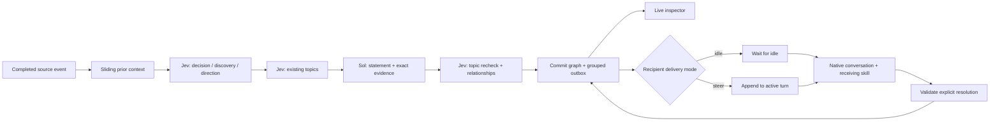

# Collaboration trial

This experiment adds a real, opt-in pipeline to the Rust service. The existing
[visual proposal](collaboration-experiment.md) remains an illustrative design;
the inspector below reads actual local state and provider responses.



## Run the included example

The export example is **synthetic test input**, not a report of a real benchmark.
Model outputs are real API responses. It includes a human decision, a reported
finding, an agent's conflicting decision, and an acknowledgement.

Build from this experiment branch. Supply `TYPESAFE_API_KEY` and `OPENAI_API_KEY`
through your secret manager in the environment that starts the service. Neither
key belongs in a JSON file, browser bundle or repository. The requests use
`jev-1.13.0` and `gpt-6.1-sol` with medium reasoning, with no fallback model.

```sh
cargo build --locked --bin voyager
trial="$HOME/.local/share/voyager-collaboration-trial"
voyager=./target/debug/voyager
"$voyager" --state "$trial" start
"$voyager" --state "$trial" collab assign examples/collaboration/assignment.json
"$voyager" --state "$trial" collab import examples/collaboration/events.json
"$voyager" --state "$trial" collab run examples/collaboration/run.json
"$voyager" --state "$trial" collab status
```

Open the returned `url`. It is a private, loopback-only, read-only inspector with
Graph, Source, Subscribers and Calls views. Click a record or relationship to
inspect evidence, provenance and responsibility. Requests, responses, token usage
and elapsed milliseconds are retained. Currency cost is not estimated.

Commands return a **queued job receipt**; `collab status` shows the current job
and outcome. Assignment and import run in FIFO order. A paused worker performs no
model calls or delivery. `collab pause` takes effect after the current event's
model calls finish. `collab run` resumes queued events; failed events remain failed
for inspection and are not automatically replayed or charged again.

## Use recorded or live conversations

Import a JSON array of `{event_id, session_id, role, text, gap?}`. Use stable source
IDs, `user` or `assistant` roles, and preserve original order. A repeated ID with
identical content is ignored; changed content under the same ID is rejected.
Keep each import below 60 KB; source text is limited to 16 KiB per event. Capture
gaps use role `gap` and `gap: true`. Do not invent missing tool evidence.

Assign each source session before processing it. An assignment contains:

```json
{
  "session_id": "registered Voyager session ID or replay source ID",
  "brief": "The actual work assigned to this agent",
  "ticket": null,
  "supervisor": null,
  "delivery": false,
  "delivery_mode": "idle"
}
```

Tickets are supplied attribution, not inferred. Topics can span tickets. Reassigning
replaces the brief and direction history and rechecks topic relevance. New topics
and detected direction changes also cause relevance checks. Initial assignment
receives a snapshot of current relevant records. After a direction change, future
updates use the revised subscriptions; older records remain available in the
inspector. PR inference, long-lived agent identity and subtopics are deferred.

For live capture, use the registered Voyager session ID and run with:

```json
{"window_chars":16000,"max_events":20,"follow":true}
```

The worker polls the service's attributed event log, records completed messages
and capture gaps, and stops after the configured number of processed source
events. It ignores unassigned sessions. Current capture contains message text and
tool lifecycle metadata, not tool arguments/results. Truncated messages become
gaps instead of silently complete evidence. A window never crosses a gap or reads
future events. `window_chars` measures source-text characters, **not tokens**;
provider token usage includes prompts, catalogue and other structured context.

Set `delivery: true` only for a registered test recipient you intend to message.
The [delivery contract](subscription-notifications.md) describes queueing,
active-turn steering, resolution and uncertain outcomes.

See the [observed trial results](collaboration-proof.md) for evidence and limits.

## Deliberate prototype boundaries

- One background worker serializes graph changes. HTTP model calls run outside
  database transactions and outside the service's native event loop. The catalogue
  cannot change underneath a classification, so no distributed locking or stale
  catalogue retry protocol is needed yet.
- SQLite stores an atomic graph snapshot and source completion, with a separate
  durable attempt log and outbox. State lives beside `events.sqlite`; restart
  begins paused. Delivery interrupted by restart becomes uncertain, never replayed.
- Independent Noul questions allow both kinds and multiple topic memberships.
  Below 0.35 is negative, above 0.65 is positive, and the middle is uncertain.
  These are experimental thresholds, not calibrated accuracy guarantees. Uncertain
  trigger candidates go to Sol; uncertain topic matches do not create a new topic.
  Subscription uncertainty retains existing membership and is visible in assessments.
- Sol can reject a candidate or return `needs_split`; no knowledge is published
  in those cases. The first slice composes at most one record per kind per event.
  Pending-topic records and all provider attempts remain inspectable.
- Jev compares same-kind records in overlapping topics for duplicates, decision
  contradictions, and discovery support/challenges. A topic is not evidence of a
  relationship. Neither recency nor authority automatically supersedes a decision.
- Limits: ten assignments, 32 topics, 200 knowledge records, 1,000 packets,
  at most 100 events in one window, and a 16 KiB native message. Hitting a limit
  stops visibly; it does not silently drop evidence or claim no match. Start a fresh
  private trial when appropriate. The UI shows 100 recent source events, 30 model
  attempts, 12 graph topics and 24 graph records; the local database retains more.
- This is local coordination under one operating-system user, not authentication
  between hostile agents. The CLI operator is trusted. The inspector URL contains
  a random access token and must remain private.
- Throughput, latency, extraction recall and collaboration gains are unproved.
  Serial provider calls can lag a busy team. Five-worker A/B experiments and
  notification preferences are the next experiments, not completed results.

API references: [TypeSafe reference](https://docs.typesafe.ai/api),
[OpenAI structured outputs](https://developers.openai.com/api/docs/guides/structured-outputs),
[Codex app-server protocol](https://developers.openai.com/codex/app-server/).
