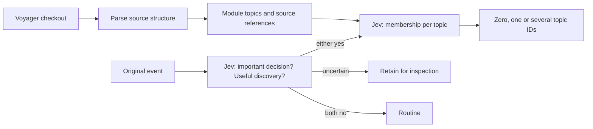

# Structural topics experiment

This branch tests whether source-derived modules provide a useful topic catalogue
for important agent messages. It is a separate scanner and recorded-event replay;
it does not alter the service's collaboration pipeline or send notifications.



## Scan

```sh
cargo run --locked --example topic_scan -- /path/to/voyager-checkout > catalogue.json
cargo run --locked --example topic_scan -- /path/to/voyager-checkout catalogue.json > refreshed.json
```

The scanner supports this repository's `Cargo.toml`, `desktop/package.json`, Rust
files under `src`, and JavaScript/CommonJS files under `desktop/src`. Each source
file is a candidate topic, grouped by its manifest package. Names come directly
from paths. It does not infer business systems or generate friendly descriptions.
This is not yet a general scanner for arbitrary layouts or other languages.

Tree-sitter extracts declarations, Rust type fields, imports, CommonJS exports,
and directly called Electron IPC channels. Each fact records its source line.
Original source hashes, checkout path and Git revision accompany the inventory.
Topic IDs are stable within the repository while paths remain unchanged; renames
are currently removal plus addition. Custom labels and migration aliases are future work.

On another explicit scan, identical source hashes reuse facts. Changed files are
parsed and their structural fingerprints compared, excluding line positions and
ordinary function bodies. Added and removed files and package dependency changes
are reported. The cache is tied to a scanner schema and checkout. Parse errors
fail the scan without replacing an existing catalogue. Source contents, tracked
status, manifests, file inventory and revision are checked again before output.
This detects ordinary concurrent edits, but is not a filesystem snapshot transaction.

The command reads and hashes source files; it does not persist full source copies.
It is an explicit incremental scan, not a watcher or lazy service refresh. Watchers,
debouncing, area-level refresh and service integration remain unimplemented.

Coverage is deliberately visible: HTML/CSS, shell scripts and the separate Rust
tests file are listed as excluded. Macro expansion, conditional compilation,
dynamic imports, generated code, cross-language call resolution and runtime
contracts are not inferred. IPC registration through a wrapper is not resolved.
A structure fingerprint is not a behavioral equivalence check: a body edit can
change behavior without changing any recorded declarations.

## Jev replay

The replay keeps source messages intact, including event and session IDs. It first
asks two independent Noul questions. Either can pass, so decisions and discoveries
can coexist. Novelty and repetition are deliberately outside these questions.
A discovery result means a reported useful finding, not independently verified truth.

When either answer exceeds 0.65, every topic receives an independent membership
question. Requests contain up to 16 questions per batch; this is an experiment
budget, not an API limit. No shortlist is used, so we can inspect all matches and
false positives. Values below 0.35 mean no; the inclusive middle band is retained
as uncertain. No match is a valid result. Uncertain importance does not silently
become false and does not cause a membership request in this trial.

Choice has a maximum of 255 options and selects one. Independent Noul membership
does not impose that catalogue-size limit, but large catalogues still consume
tokens. Hierarchical candidate selection can be evaluated later against this
full-catalogue reference. Per-question instructions include the complete candidate
because question IDs are routing keys, not model input.

```sh
python3 experiments/structural_topics.py prepare \
  --catalogue catalogue.json --events recorded-events.json \
  --output /private/path/trial --sequences 1,16,25,26,27,53,58,60,65,74,76,77
python3 experiments/structural_topics.py run \
  --output /private/path/trial --adapter /path/to/installed/jev/adapter.py
```

Load `TYPESAFE_API_KEY` through the approved local secret loader first. The runner
uses the installed Jev skill's canonical adapter and verifies its pinned
`jev-1.13.0` model. The adapter exposes `Adapter.ask(state, questions)` and records
`seconds` and `input_tokens` in `metrics`. It is an explicit local dependency;
the replay is not a standalone packaged client.

Input is a JSON array of `{seq, event}` objects. An event has `event_id`,
`session_id`, `role` and `text`. The default sequence numbers and partial labels
refer to the development trial. Other sequences can be supplied and remain
unlabelled unless deliberately labelled before running. Four authored calibration
cases are labeled separately from recorded messages. They check a lifecycle
decision, an attachment finding, membership of both sides of IPC, and routine text.
They are not held-out evaluation evidence.

Preparation freezes the catalogue, messages, questions and partial expected
outcomes. The runner records exact requests, answers, input tokens, timing and
code hashes. Output files are created exclusively; an interrupted run is never
resumed or retried automatically. `report` can render whatever receipts exist.
Raw sources, provider requests and reports stay outside Git in a private directory.
No generative model, knowledge rewrite, relationship comparison or subscriber
delivery runs in this experiment.

## Checks

The first development replay scanned 33 modules from revision
`ce021669db475da8c959e9decddcf72f4e6ae0ad`. An unchanged second scan reused all 33
inventories and parsed none. The final scanner was replayed against 12 recorded
messages plus four authored calibration examples, with questions and labels frozen
before provider calls. This used 58 requests and 459,486 input tokens in total.
Median summed request latency per recorded event was 1.123 seconds; this is a
small serial replay measurement, not a production latency guarantee.

The IPC calibration matched both main and preload modules. A recorded interface
agreement matched main, preload and renderer. Two recorded placement findings
matched the main module. Of 20 partially labelled recorded judgments, 18 agreed,
one was wrong and one remained uncertain. All 12 calibration judgments agreed.
These labels do not cover every possible topic match, so they do not establish
overall routing precision or recall. In particular, the lifecycle example matched
six modules and needs review for excess fan-out.

The importance gate incorrectly treated a readiness instruction as a development
decision. An implicit panel change was uncertain for the main module. Eight of
eleven routed recorded messages had no confirmed topic, including missing feature
areas, environment/commit context, and implicit module references. This supports
keeping an unassigned result; it also shows that source declarations alone do not
yet supply a sufficiently useful topic vocabulary. No prompt tuning or threshold
change was made to hide these failures. Selecting every module is relatively
expensive and is a reference approach for future narrowing experiments.

```sh
cargo fmt --check
cargo test --locked
cargo test --locked --example topic_scan
cargo clippy --locked --all-targets -- -D warnings
cargo build --locked --example topic_scan
python3 experiments/test_structural_topics.py target/debug/examples/topic_scan
```

The scanner checks body-only edits against signature changes, IPC/dependency
changes, moving fields between types, arrow parameters, and malformed source.
The command-level test creates a disposable Git checkout, verifies cache reuse,
module addition/removal and manifest changes, then verifies failure preserves
the old catalogue.

References: [TypeSafe API](https://docs.typesafe.ai/api),
[Noul](https://docs.typesafe.ai/primitives/noul),
[hierarchical classification](https://docs.typesafe.ai/cookbooks/hierarchical_classification),
[Tree-sitter](https://tree-sitter.github.io/tree-sitter/).
